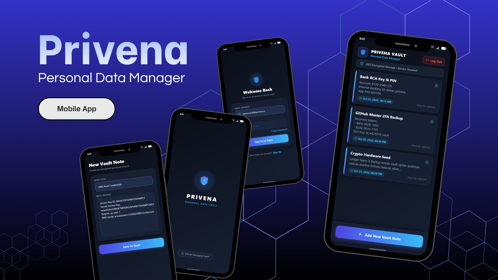

# Privena — Personal Data Management

[-brightgreen?logo=android&logoColor=white)](https://www.android.com/)
[-blue?logo=android&logoColor=white)](https://developer.android.com/about/versions/12)
[](https://openjdk.org/)
[](https://realm.io/)
[](https://firebase.google.com/products/auth)
[](https://firebase.google.com/products/realtime-database)
[](https://developer.android.com/topic/libraries/view-binding)
[](https://gradle.org/)
[](#permissions--device-requirements)
[](./LICENSE)

<p align="center">
  
</p>

Privena is a native Android personal data vault and confidential records management application engineered to store, organize, and safeguard sensitive personal information on mobile devices. Designed with a luxury dark cybersecurity aesthetic, Privena provides individuals with a secure digital repository for storing critical personal notes, account recovery tokens, financial memos, identity records, and confidential remarks away from unprotected cloud clipboards and plain-text note applications.

Built with native Java on Android SDK 32, the application couples high-performance, offline-first local persistence via Realm Database 10.8.0 with cloud-backed user identity management powered by Google Firebase Authentication and Firebase Realtime Database. Privena implements Android Jetpack ViewBinding for type-safe view interaction, reactive UI updates through Realm change listeners, an automated auto-login credential persistence pipeline via encrypted `SharedPreferences`, and an edge-to-edge dark luxury visual theme crafted with custom neon gradients and elevation components.

---

## Features

- **Secure User Authentication & Account Protection**:
  - **Email & Password Authentication**: Full sign-up and sign-in pipelines powered by Firebase Authentication (`createUserWithEmailAndPassword`, `signInWithEmailAndPassword`).
  - **Cloud User Profile Persistence**: Automatic user record provisioning into Firebase Realtime Database under the `userpersonal/{uid}` node upon registration.
  - **Persistent Auto-Login Session**: Automated session state caching in private `SharedPreferences` (`autologin` flag), bypassing credentials entry and launching directly into the dashboard upon return visits.
  - **Automated Password Recovery**: Integrated self-service password reset workflow (`sendPasswordResetEmail`) delivering recovery instructions directly to the user's verified email address.
  - **Instant Session Termination**: Secure one-tap logout button clearing active Firebase authentication tokens and redirecting back to the authentication gateway.
- **Vault Note Management (CRUD Lifecycle)**:
  - **Confidential Note Creation**: Rapid recording interface allowing users to capture custom note titles and extensive, multiline narrative descriptions.
  - **Reactive Chronological Stream**: Dashboard `RecyclerView` queries local storage and sorts all records by creation epoch (`createdTime`) in descending order (`Sort.DESCENDING`), displaying newest records at the top.
  - **Live Auto-Updating UI**: Driven by Realm's asynchronous `RealmChangeListener`, ensuring any added, edited, or removed vault record is instantaneously reflected in the UI without requiring pull-to-refresh or activity restarts.
  - **Contextual Long-Press Management**: Long-clicking any vault note surface summons an Android native `PopupMenu` providing immediate access to "EDIT" and "DELETE" actions.
  - **In-Place Record Modification**: Pre-populated edit screen allowing immediate adjustments to titles and descriptions, persisted back to Realm asynchronously via transactional execution blocks.
  - **Atomic Record Deletion**: Immediate deletion operations wrapped within Realm write transactions (`deleteFromRealm()`), purging sensitive records completely from the local database file.
- **High-Performance Realm Object Storage**:
  - Offline-first architecture powered by the Realm 10.8.0 mobile database engine.
  - Zero-copy C++ core architecture delivering millisecond-fast query execution and eliminating traditional SQLite ORM serialization overhead.
  - Guaranteed offline accessibility: users can view, search, create, modify, and delete their confidential vault records even without an active internet connection.
- **Premium Dark Luxury Cyber Aesthetic**:
  - Bespoke color palette combining deep midnight backgrounds (`#0B0F19`, `#111827`), glowing neon indigo accents (`#6366F1`), and vivid cyan highlights (`#38BDF8`).
  - Luxury glassmorphic card containers (`bg_card_luxury`, `bg_card_note`) equipped with decorative vertical cyan accent strips and subtle border strokes.
  - Security indicator badges (`bg_badge_secure`, `ic_shield_check_vector`, `ic_lock_vector`) visually validating encrypted storage states across all application activities.
  - Human-readable timestamp formatting utilizing Java's `DateFormat.getDateTimeInstance()` to present date and time metadata for every note.
- **Zero Runtime Device Permissions**:
  - Strict zero-permission architecture: requires zero runtime prompts for camera, audio, location, external storage, contacts, or Bluetooth hardware.
  - Drastically mitigates mobile attack vectors and guarantees that user data remains strictly isolated within the application's private sandbox.

---

## Preview & Demo

### Authentication Gateway & Vault Dashboard Showcase

<p align="center">
  
</p>

_Showcase of Privena's core navigation flows: The branded splash screen initiates a 3-second gateway verifying authentication state before routing. The dark luxury Sign In screen features custom styled input fields with glowing icons and quick-action password recovery. The Main Dashboard presents the encrypted vault overview, displaying real-time record counts, chronological note cards with cyan accent indicators, formatted timestamp badges, and the bottom dock action button._

---

### Record Creation, Contextual Management & In-Place Editing

<p align="center">
  
</p>

_Detailed demonstration of Privena's record manipulation workflows: The New Vault Note creation interface allows users to formulate confidential entries within elevated card containers. The contextual options menu (summoned via long-press) presents one-tap Edit and Delete controls. The Edit Note view pre-populates existing record data for fast transactional updates._

---

## Platform Support

| Dimension | Specification | Verification Source |
| :--- | :--- | :--- |
| **Target Operating System** | Android | Android Manifest & Gradle Build Configuration |
| **Minimum OS Version** | Android 7.0 (Nougat, API Level 24) | `minSdk 24` in `app/build.gradle` |
| **Target OS Version** | Android 12L (API Level 32) | `targetSdk 32` in `app/build.gradle` |
| **Compile SDK Version** | Android 12L (API Level 32) | `compileSdk 32` in `app/build.gradle` |
| **Supported CPU Architectures** | `arm64-v8a`, `armeabi-v7a`, `x86`, `x86_64` | Realm Native C++ Engine & Android Dalvik / ART Virtual Machine |
| **Form Factors** | Smartphones & Tablets | Responsive layout definitions with `ScrollView` and `RecyclerView` |
| **Tested Targets** | Android Emulators & Physical Hardware (API 24–32+) | Local instrumentation and component test specifications |
| **Published Targets** | Standalone Debug APK Package | `app-debug.apk` assembled via Gradle build pipeline |

---

## Tech Stack

### Core Platform & Languages

- **Programming Language**: Java 8 (`sourceCompatibility = JavaVersion.VERSION_1_8`, `targetCompatibility = JavaVersion.VERSION_1_8`)
- **Target Platform**: Native Android SDK (API Level 24 to 32)
- **Architecture Pattern**: Model-View-Controller (MVC) combined with Android Jetpack ViewBinding

### Local Data Storage & Persistence

- **Embedded Object Database**: Realm Android 10.8.0 (`io.realm:realm-android`)
- **Reactive Data Observers**: Realm `RealmChangeListener` and `RealmResults` live collections
- **Transactional Consistency**: Synchronous and asynchronous write transactions (`beginTransaction()`, `executeTransactionAsync()`)
- **Session & State Persistence**: Android `SharedPreferences` ("userpersonal" and "userdiary" private storage)

### Cloud Backend & Identity Management

- **Cloud Platform**: Google Firebase Services
- **Firebase Bill of Materials (BoM)**: Version 31.1.1 (`com.google.firebase:firebase-bom:31.1.1`)
- **Authentication**: Firebase Auth (`com.google.firebase:firebase-auth`)
- **Cloud Database**: Firebase Realtime Database (`com.google.firebase:firebase-database`)
- **Google Services Plugin**: Version 4.3.13 (`com.google.gms:google-services:4.3.13`)

### UI Framework & System Integration

- **View Binding**: Android Jetpack ViewBinding (`buildFeatures { viewBinding true }`)
- **Design System & Components**: Google Material Components 1.7.0 (`com.google.android.material:material:1.7.0`)
- **Core Compatibility**: AndroidX AppCompat 1.5.1 (`androidx.appcompat:appcompat:1.5.1`)
- **Dynamic List Management**: AndroidX RecyclerView with custom `MyAdapter` and `LinearLayoutManager`
- **Constraint Layout Engine**: AndroidX ConstraintLayout 2.1.4 (`androidx.constraintlayout:constraintlayout:2.1.4`)
- **Vector Graphics & Drawables**: Custom SVG-derived Android vector drawables with multi-layer color blending

### Build System & Toolchain

- **Build Automation**: Gradle 7.4 (`gradle-wrapper.properties`)
- **Android Gradle Plugin (AGP)**: Version 7.3.1
- **Bytecode Shrinking & Proguard**: Standard Android Proguard configuration (`app/proguard-rules.pro`)

### Testing Frameworks

- **Unit Testing**: JUnit 4.13.2 (`junit:junit:4.13.2`)
- **Instrumented Testing**: AndroidX Test JUnit Extension 1.1.4 (`androidx.test.ext:junit:1.1.4`)
- **UI & Interaction Testing**: AndroidX Espresso Core 3.5.0 (`androidx.test.espresso:espresso-core:3.5.0`)

---

## Prerequisites

### Developer Environment

Before compiling and running Privena from source, ensure your development workstation meets the following criteria:

- **Java Development Kit (JDK)**: JDK 11 (recommended for Gradle 7.4 / AGP 7.3.1 compatibility).
- **Android Studio**: Android Studio Electric Eel (2022.1.1), Flamingo, Hedgehog, or Ladybug/newer.
- **Android SDK Platforms**: Android SDK Platform 32 (Android 12L) installed via the Android SDK Manager.
- **Android SDK Build-Tools**: Version 32.0.0 or compatible minor release.
- **Firebase Project Credentials**: A valid `google-services.json` file associated with your Firebase project placed in the `app/` folder.
- **Execution Target**:
  - Android Virtual Device (AVD) emulator configured with API Level 24 or higher.
  - Physical Android smartphone running Android 7.0+ with **USB Debugging** enabled in Developer Settings.

### End-User Requirements

For users installing the standalone pre-compiled package:

- **Operating System**: Android 7.0 (Nougat, API Level 24) or newer.
- **Device Storage**: Minimum 35 MB of free internal storage for the application package, native Realm libraries, and local database storage.
- **Network Connectivity**: Active Wi-Fi or cellular data connection required during initial account registration, sign-in, and password reset operations. All subsequent note operations run fully offline.

---

## Installation & Setup

### Developer Setup (Build from Source)

1. **Clone the Repository**:
   ```bash
   git clone https://github.com/weztcy/Privena---Personal-Data-Management.git
   cd "Privena---Personal-Data-Management"
   ```

2. **Configure Firebase Services**:
   - Ensure an active Firebase project exists on the [Firebase Console](https://console.firebase.google.com/).
   - Enable **Email/Password** sign-in provider under **Build > Authentication > Sign-in method**.
   - Create and configure a **Firebase Realtime Database** instance.
   - Download the generated `google-services.json` file from Firebase and place it directly into the `app/` directory (e.g. `app/google-services.json`).

3. **Open Project in Android Studio**:
   - Launch Android Studio.
   - Choose **File > Open...** and select the root directory of the cloned repository.
   - Allow Android Studio and Gradle to resolve dependencies and sync the build model.

4. **Build the Debug Application**:
   ```bash
   # On macOS / Linux
   ./gradlew assembleDebug

   # On Windows (PowerShell / Command Prompt)
   .\gradlew.bat assembleDebug
   ```

5. **Deploy to Connected Device or Emulator**:
   ```bash
   # On macOS / Linux
   ./gradlew installDebug

   # On Windows (PowerShell / Command Prompt)
   .\gradlew.bat installDebug
   ```

---

## Environment Variables & Configuration

Privena integrates with Google Firebase for identity services and real-time cloud profile mapping. All project credentials are fundamentally driven by the Android Google Services configuration.

### Firebase Configuration (`google-services.json`)

The client configuration file must contain valid project identifiers without exposing sensitive production keys in public version control. The expected structure is outlined below:

```json
{
  "project_info": {
    "project_number": "<YOUR_FIREBASE_PROJECT_NUMBER>",
    "firebase_url": "https://<YOUR_PROJECT_ID>-default-rtdb.firebaseio.com",
    "project_id": "<YOUR_PROJECT_ID>",
    "storage_bucket": "<YOUR_PROJECT_ID>.appspot.com"
  },
  "client": [
    {
      "client_info": {
        "mobilesdk_app_id": "1:<PROJECT_NUMBER>:android:<APP_HASH>",
        "android_client_info": {
          "package_name": "com.yodimpra.personaldata"
        }
      },
      "api_key": [
        {
          "current_key": "<YOUR_FIREBASE_MOBILE_API_KEY>"
        }
      ]
    }
  ],
  "configuration_version": "1"
}
```

### Firebase Realtime Database Security Rules

To ensure authenticated users can only access their personal metadata profiles, apply the following security rules in the Firebase Realtime Database console:

```json
{
  "rules": {
    "userpersonal": {
      "$uid": {
        ".read": "auth != null && auth.uid == $uid",
        ".write": "auth != null && auth.uid == $uid"
      }
    }
  }
}
```

### Local Preferences Configuration

The application utilizes private Android `SharedPreferences` instances to manage local session flags:

| Preference Name | Key | Type | Description |
| :--- | :--- | :--- | :--- |
| `userpersonal` | `autologin` | `Boolean` | Determines if user bypasses the login screen upon launch |
| `userpersonal` | `unique` | `String` | Caches the authenticated Firebase User UID locally |
| `userdiary` | `autologin` | `Boolean` | Fallback session state tracker for credential persistence |

---

## Usage / Getting Started

### 1. Application Launch & Automated Session Detection
- Upon launching Privena, the animated splash screen activates for 3 seconds.
- The system checks `preferences.getBoolean("autologin", false)`.
- If an active session is detected, the user is transitioned directly into the `Dashboard`.
- If no active session exists, the application presents the `Signin` activity.

### 2. User Account Registration
- From the Sign In screen, tap **Sign Up** to open the registration view.
- Enter a desired **Username**, valid **Email Address**, and a secure **Password**.
- Tap **Sign Up**. The application contacts Firebase Authentication to create the user account and persists the user record in Firebase Realtime Database.
- Upon completion, the user is redirected to the sign-in screen with an automated success notification.

### 3. Signing In & Account Recovery
- Provide registered credentials and tap **Sign In**. The application authenticates via Firebase Auth, sets the `autologin` flag to `true`, and routes to the main vault.
- If a password is forgotten, tap **Forgot Password?** to navigate to the password recovery screen.
- Enter the registered email and tap **Reset Password**. A password recovery email will be dispatched immediately.

### 4. Creating a Vault Note
- On the Dashboard, tap the bottom action button: **Add New Vault Note**.
- Input a descriptive **Note Title** and comprehensive **Note Description**.
- Tap **Save Note**. The record is committed into the local Realm database along with a precise timestamp (`System.currentTimeMillis()`).
- The user is returned to the Dashboard where the new note is immediately displayed at the top of the list.

### 5. Managing Existing Notes (Edit & Delete)
- **View Full Note**: Note cards display the title, formatted creation date/time, and truncated description preview.
- **Contextual Actions Menu**: Perform a **long-press** gesture on any note card to reveal the contextual popup menu.
- **Edit Note**: Select **EDIT** to open the modification interface. Update the title or body and tap **Save Changes**. Changes are updated in Realm asynchronously.
- **Delete Note**: Select **DELETE** to immediately remove the record from Realm storage. The item is dismissed from the screen in real time.

### 6. Logging Out
- Tap the **Log Out** button located in the top app bar of the Dashboard.
- The application executes `mAuth.signOut()`, resets session context, and routes back to the authentication screen.

---

## Available Scripts / Commands

Privena utilizes the Gradle wrapper toolchain for all development, maintenance, and verification workflows.

| Task / Command | Platform | Description |
| :--- | :--- | :--- |
| `./gradlew assembleDebug` | macOS / Linux | Compiles and builds the debug APK package |
| `.\gradlew.bat assembleDebug` | Windows | Compiles and builds the debug APK package on Windows |
| `./gradlew assembleRelease` | macOS / Linux | Builds an optimized, unsigned release APK package |
| `.\gradlew.bat assembleRelease` | Windows | Builds an optimized, unsigned release APK package on Windows |
| `./gradlew testDebugUnitTest` | macOS / Linux | Runs host JVM local unit tests via JUnit 4 |
| `.\gradlew.bat testDebugUnitTest` | Windows | Runs host JVM local unit tests via JUnit 4 on Windows |
| `./gradlew connectedAndroidTest` | macOS / Linux | Executes on-device instrumentation tests via AndroidX Runner |
| `.\gradlew.bat connectedAndroidTest` | Windows | Executes on-device instrumentation tests on Windows |
| `./gradlew lint` | macOS / Linux | Executes Android Lint code inspection analysis |
| `.\gradlew.bat lint` | Windows | Executes Android Lint code inspection analysis on Windows |
| `./gradlew clean` | macOS / Linux | Purges generated build outputs and intermediate caches |
| `.\gradlew.bat clean` | Windows | Purges generated build outputs and intermediate caches on Windows |

---

## Permissions & Device Requirements

### Declared Manifest Permissions

Privena operates with **zero runtime device permissions**, as verified in `app/src/main/AndroidManifest.xml`:

- **Camera**: Not requested.
- **Microphone / Audio**: Not requested.
- **Location (Fine / Coarse)**: Not requested.
- **Read / Write External Storage**: Not requested.
- **Contacts / Phone State**: Not requested.
- **Bluetooth / Nearby Devices**: Not requested.

### Network Requirements

The application relies on standard internet connectivity to communicate with Firebase Authentication and Firebase Realtime Database. On modern Android versions (API 24+), standard network sockets for HTTPS API operations do not require runtime permission dialogs.

### Storage Sandbox

All Realm database files (`default.realm`, `default.realm.lock`, `default.realm.management`) and `SharedPreferences` XML configurations are strictly contained within the application's private, sandboxed internal storage directory:
- Database files: `/data/data/com.yodimpra.personaldata/files/default.realm`
- Session preferences: `/data/data/com.yodimpra.personaldata/shared_prefs/userpersonal.xml`

This internal storage is sandboxed by Linux kernel user ID boundaries on Android, preventing any other installed application from accessing or inspecting the vault contents.

---

## Data Storage & Synchronization

### Local Object Persistence (Realm Database)

All personal notes and confidential records created within Privena are stored exclusively on the device using Realm Database 10.8.0:

- **Entity Model (`Note.java`)**:
  - `title` (`String`): Title heading of the vault note.
  - `description` (`String`): Body content of the confidential record.
  - `createdTime` (`long`): System epoch millisecond timestamp representing creation time.
- **Reactive UI Binding**:
  - Queried via `realm.where(Note.class).sort("createdTime", Sort.DESCENDING).findAll()`.
  - Backed by `RealmChangeListener<RealmResults<Note>>` which automatically invokes `myAdapter.notifyDataSetChanged()` whenever underlying records change.
- **Transactional Safety**:
  - Write operations execute within strict transactions (`realm.beginTransaction()` and `realm.commitTransaction()`).
  - Asynchronous background transactions utilize `realm.executeTransactionAsync(...)` to prevent blocking the Android main UI thread during edits.

### Cloud Identity Storage (Firebase)

- **Firebase Authentication**: Manages encrypted user credentials, email verification tokens, and session tickets on Google's cloud infrastructure.
- **Firebase Realtime Database**: Stores basic user directory metadata mapped by Firebase UID:
  - `username` (`String`): Display identity name.
  - `email` (`String`): Registered contact email address.

> [!NOTE]
> Personal vault notes are stored **strictly in local Realm storage on the device**. Note contents are not transmitted to or stored within Firebase Realtime Database, ensuring private user notes never leave the device.

---

## Testing

Privena incorporates automated testing configurations for host-based JVM verification and on-device instrumentation.

### Test Structure

- **Host Unit Testing (`app/src/test/java/com/yodimpra/personaldata/`)**:
  - `ExampleUnitTest.java`: Validates basic JVM test runner integrity and math assertions.
  - Executes directly on the development machine host without requiring Android emulator runtime.
- **Android Instrumentation Testing (`app/src/androidTest/java/com/yodimpra/personaldata/`)**:
  - `ExampleInstrumentedTest.java`: Validates runtime package identity (`com.yodimpra.personaldata`) and application context initialization using `AndroidJUnit4` and `InstrumentationRegistry`.

### Executing Local Unit Tests

Run the following command to execute the host unit test suite:

```bash
# On macOS / Linux
./gradlew testDebugUnitTest

# On Windows (PowerShell / Command Prompt)
.\gradlew.bat testDebugUnitTest
```

Test reports are generated in HTML format at `app/build/reports/tests/testDebugUnitTest/index.html`.

### Executing Instrumentation Tests

With an active Android emulator or physical device connected via ADB:

```bash
# On macOS / Linux
./gradlew connectedAndroidTest

# On Windows (PowerShell / Command Prompt)
.\gradlew.bat connectedAndroidTest
```

Test execution results are generated at `app/build/reports/androidTests/connected/index.html`.

---

## Build & Packaging

Privena supports standard Android build variants configured through the Gradle build system.

### Debug Build

The debug build includes debugging metadata, unminified bytecode, and default diagnostic logging:

```bash
# On macOS / Linux
./gradlew assembleDebug

# On Windows (PowerShell / Command Prompt)
.\gradlew.bat assembleDebug
```

- **Output Artifact**: `app/build/outputs/apk/debug/app-debug.apk`
- **Signing**: Automatically signed with the default Android debug keystore (`~/.android/debug.keystore`).

### Release Build

To generate an optimized release APK:

```bash
# On macOS / Linux
./gradlew assembleRelease

# On Windows (PowerShell / Command Prompt)
.\gradlew.bat assembleRelease
```

- **Output Artifact**: `app/build/outputs/apk/release/app-release-unsigned.apk`
- **Proguard Rules**: Defined in `app/proguard-rules.pro`. When enabling code shrinking (`minifyEnabled true`), ensure Realm and Firebase model reflection rules are preserved.

---

## License

Please see the [LICENSE](./LICENSE) file for the terms and conditions governing the use, modification, and distribution of this project.

## Author & Contact

**Yohanes Dimas Pratama**

- GitHub: [github.com/weztcy](https://github.com/weztcy)
- Portfolio: [dimaspratama.vercel.app](https://dimaspratama.vercel.app)
- LinkedIn: [linkedin.com/in/yohanes-dimas](https://www.linkedin.com/in/yohanes-dimas)
