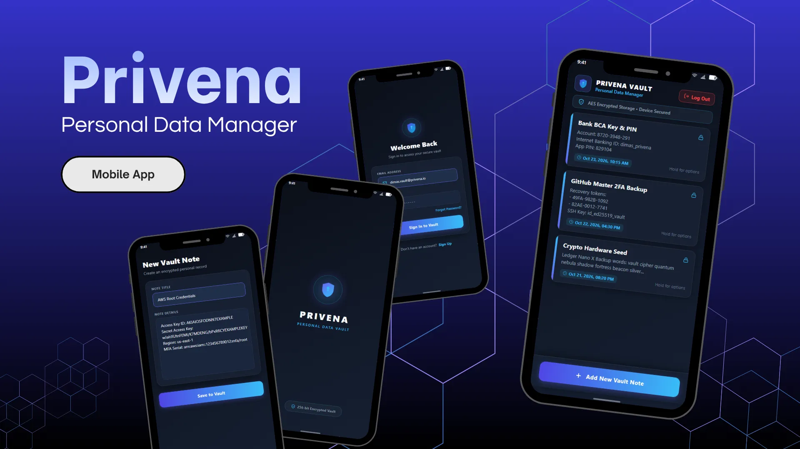
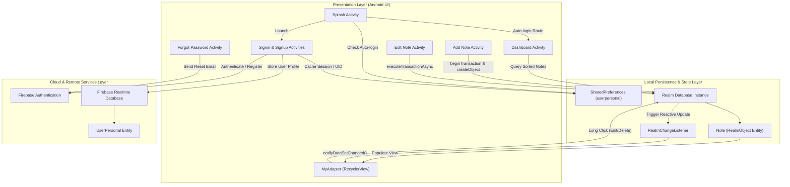
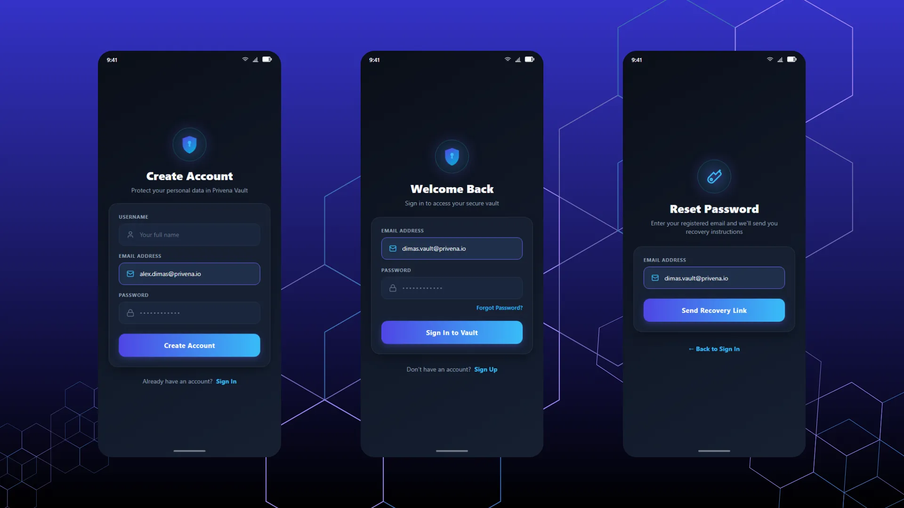
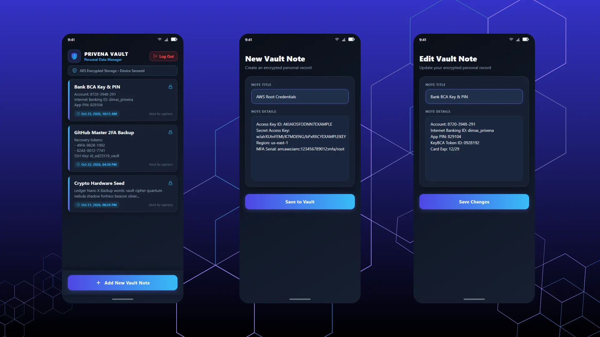

# Privena - Personal Data Management




## Project Overview

Privena is a native Android personal data and credential management vault designed to provide secure, offline-accessible storage for sensitive personal notes, recovery keys, and confidential records. Developed in Java and powered by an embedded Realm database engine alongside Firebase Authentication, the application safeguards sensitive data against unauthorized local viewing while eliminating dependency on persistent network connectivity for daily operations. By pairing client-side reactive data synchronization with cloud identity verification, Privena delivers a seamless and reliable mobile vault for security-conscious individuals seeking complete control over their personal records.

## Key Features

- **Secure Cloud Authentication**: User onboarding, login, and self-service password reset recovery powered by Firebase Authentication.
- **Offline-First Vault Storage**: High-performance local persistence built on an embedded Realm database engine, enabling sub-millisecond CRUD operations without internet access.
- **Comprehensive Record Management**: Full lifecycle creation, viewing, updating, and deletion of personal credential notes.
- **Reactive UI Synchronization**: Automatic list refreshes driven by `RealmChangeListener` and Android `RecyclerView`, eliminating manual UI reload triggers.
- **Contextual Record Actions**: Intuitive long-click interaction model surfacing rapid Edit and Delete popup actions for any vault entry.
- **Persistent Auto-Login Sessions**: Session token persistence via Android `SharedPreferences`, seamlessly directing returning users straight to their vault.

## Supported Platforms

| Platform | Operating System | Minimum Version | Support / Test Status |
| --- | --- | --- | --- |
| Mobile | Android (ARM / x86) | Android 7.0 (API Level 24, Nougat) | Verified & Tested (Target API 32, Android 12L) |

## Tech Stack

| Category | Technology | Purpose |
| --- | --- | --- |
| Primary Language | Java 8 (Java SE 1.8) | Core application programming and object-oriented business logic |
| Platform & OS | Android SDK (API 24–32) | Native Android operating system APIs and lifecycle components |
| UI Framework | Android Jetpack ViewBinding | Type-safe and null-safe view reference binding replacing `findViewById` |
| UI Components | Google Material Components (v1.7.0) | Material design styling, typography, elevation, and UI controls |
| Layout Engine | AndroidX ConstraintLayout (v2.1.4) | Responsive and flat view hierarchies for mobile phone screens |
| Local Persistence | Realm Mobile Database (v10.8.0) | High-speed embedded object database engine for offline vault notes |
| Cloud Authentication | Firebase Authentication (BoM v31.1.1) | Secure email and password user authentication and password recovery |
| Remote Storage | Firebase Realtime Database | Cloud synchronization of user profiles and unique vault identifiers |
| Session Cache | Android SharedPreferences | Persistent storage for auto-login state and active user UID |
| Build System | Gradle 7.3.1 & Android Gradle Plugin | Automated compilation, resource packaging, and APK artifact generation |
| Unit Testing | JUnit 4 (v4.13.2) | Local unit testing of data structures and utility classes |
| UI Testing | AndroidX Test & Espresso (v3.5.0) | Instrumented UI testing and view interaction verification |

## Application Architecture

Privena is structured into decoupled presentation, local persistence, and remote authentication layers. ViewBinding connects Android Activity layouts directly to UI logic, eliminating runtime null pointer risks. The local persistence layer utilizes an embedded Realm database engine operating in native memory space to store note objects, notifying the active `RecyclerView` via `RealmChangeListener` upon data mutation. Remote cloud services through Firebase isolate user identity management and credential verification from local offline vault records.



## Screenshots / Preview

### 1. Account Authentication & Security Recovery Flow

Comprehensive onboarding interface covering new user registration (`Signup`), credential-based login (`Signin`) with session persistence, and self-service email recovery (`Forgot`). Designed with high-contrast dark themes and clear input validation for streamlined security interactions.

### 2. Vault Management & Record Lifecycle Interface

Core personal vault interface displaying chronologically sorted credential cards on the main dashboard (`Dashboard`), alongside structured record creation (`AddNoteActivity`) and asynchronous record modification (`EditNoteActivity`) modals equipped with contextual edit and delete operations.

## Prerequisites

Before building or running Privena, ensure your development environment satisfies the following requirements:

- **Android Studio**: Android Studio Chipmunk (2021.2.1) or newer.
- **Java Development Kit (JDK)**: JDK 11 or compatible Java 8+ runtime environment.
- **Android SDK**: Android SDK Platform Tools for API Level 32 with minimum target support for API Level 24.
- **Target Device / Emulator**: Physical Android smartphone or Android Virtual Device (AVD) running Android 7.0 (Nougat, API 24) or higher.
- **Google Firebase Project**: Active Firebase project with Email/Password Authentication enabled and a registered `google-services.json` file.

## Installation & Setup

1. **Clone the repository**:
   ```bash
   git clone https://github.com/weztcy/Privena---Personal-Data-Management.git
   cd "Privena - Personal Data Management"
   ```

2. **Add Firebase configuration**:
   Download your project's `google-services.json` from the Firebase Console and place it into the `app/` directory:
   ```text
   app/google-services.json
   ```

3. **Open project in Android Studio**:
   Open Android Studio, select **File > Open**, navigate to the cloned repository directory, and click **OK**. Wait for Gradle to download dependencies and sync the project.

4. **Build the application**:
   Compile the debug APK using the Gradle wrapper:
   ```bash
   ./gradlew assembleDebug
   ```

5. **Deploy to device or emulator**:
   Connect an Android device via USB debugging or start an emulator, then execute:
   ```bash
   adb install app/build/outputs/apk/debug/app-debug.apk
   ```

## Application Configuration

Privena utilizes build-time Gradle declarations, Android manifests, and local preferences to configure runtime operation:

| Configuration Parameter | Description | Default / Example Value |
| --- | --- | --- |
| `google-services.json` | Google Services JSON configuration binding Firebase services to application package | `app/google-services.json` |
| `applicationId` | Unique Android application package identifier | `com.yodimpra.personaldata` |
| `minSdk` | Minimum Android OS API level required to install and run the app | `24` (Android 7.0 Nougat) |
| `targetSdk` | Targeted Android OS API level verified for runtime behavior | `32` (Android 12L) |
| `compileSdk` | Android SDK level used during compilation | `32` |
| `SharedPreferences Name` | Internal key-value preference file for session caching | `"userpersonal"` / `"userdiary"` |
| `autologin` | Boolean preference determining automatic dashboard routing on startup | `true` / `false` |
| `unique` | Persistent user UID token received from Firebase Authentication | Firebase User UID string |
| `Realm Instance` | Embedded database instance configuration initialized at runtime | `Realm.getDefaultInstance()` |

## API Integration

Privena integrates with Google Firebase services to manage user authentication and identity mapping:

| API / Service | Purpose | Usage |
| --- | --- | --- |
| Firebase Authentication | User account creation, sign-in validation, and password recovery | `FirebaseAuth.createUserWithEmailAndPassword()`, `signInWithEmailAndPassword()`, `sendPasswordResetEmail()` |
| Firebase Realtime Database | Cloud synchronization of user profiles tied to unique authentication UIDs | `FirebaseDatabase.getInstance().getReference("userpersonal")` |

## Database & Local Storage

The primary offline vault storage is managed by Realm Mobile Database, offering fast query speeds and object-relational mapping without requiring complex SQL statements.

| Storage Engine | Storage Type | Scope & Purpose |
| --- | --- | --- |
| Realm Mobile Database | Embedded NoSQL Object Database | Stores local vault records (`Note` entity: `title`, `description`, `createdTime`) with descending chronological sorting |
| Android SharedPreferences | Persistent Key-Value XML Store | Caches session credentials, `autologin` boolean state, and user UID tokens locally on the device |

Vault records are persisted and queried through standard Realm transactions:

```java
Realm realm = Realm.getDefaultInstance();
realm.beginTransaction();
Note note = realm.createObject(Note.class);
note.setTitle(title);
note.setDescription(description);
note.setCreatedTime(System.currentTimeMillis());
realm.commitTransaction();
```

## Authentication & Authorization

Authentication is managed via Firebase Authentication with local session caching:

- **Email & Password Authentication**: Validates user credentials securely against Firebase backend endpoints.
- **Account Registration**: Generates a unique Firebase UID and provisions a corresponding profile record in Firebase Realtime Database.
- **Self-Service Password Recovery**: Sends automated password recovery emails to the user's registered email address.
- **Session Persistence**: Caches successful authentication flags in `SharedPreferences`, bypassing the sign-in screen on subsequent application launches.
- **Explicit Sign-Out**: Revokes the active session via `FirebaseAuth.getInstance().signOut()` and directs the user back to the login interface.

## Testing

The project is configured with unit tests and instrumented Android tests to verify data models and UI component behavior:

- **Unit Testing**: Tests core data models and business logic without Android device dependencies using JUnit 4.
- **Instrumented Testing**: Tests user interactions, activity lifecycles, and view hierarchies using AndroidX Test Runner and Espresso.

Execute tests using the Gradle wrapper:

```bash
# Run local unit tests
./gradlew test

# Run instrumented UI tests on connected device/emulator
./gradlew connectedAndroidTest
```

## Build & Packaging

The application is built and packaged using the standard Android Gradle plugin:

1. **Clean build directory**:
   ```bash
   ./gradlew clean
   ```

2. **Assemble Debug APK**:
   ```bash
   ./gradlew assembleDebug
   ```
   Output artifact: `app/build/outputs/apk/debug/app-debug.apk`

3. **Assemble Release APK**:
   ```bash
   ./gradlew assembleRelease
   ```
   Output artifact: `app/build/outputs/apk/release/app-release-unsigned.apk`

## Usage

Privena provides an intuitive workflow for managing confidential personal notes and records:

1. **Launch the Application**: Open Privena on your Android device. The splash screen will check your session status.
2. **Authenticate or Register**: If launching for the first time, tap **Sign Up** to create an account with your username, email, and password. Returning users can log in directly or use the **Forgot Password** link if needed.
3. **View the Dashboard**: Once authenticated, the main dashboard displays all stored vault records sorted chronologically.
4. **Add a Vault Note**: Tap the **+ Add New Vault Note** button at the bottom of the screen. Enter a title and description, then tap **Save to Vault** to commit the entry to Realm storage.
5. **Edit or Delete a Note**: Long-press any existing note card in the list to reveal the contextual menu. Select **EDIT** to modify title or details, or **DELETE** to remove the record immediately.
6. **Sign Out**: Tap the **Log Out** button on the dashboard header to terminate your session and return to the sign-in screen.

## Contributing

Contributions to Privena are welcome. Please follow this standard contribution workflow:

1. Fork the repository.
2. Create a branch for the change.
3. Make the changes.
4. Validate or test the changes when applicable.
5. Commit and push the branch.
6. Open a pull request with a clear explanation.

## License

This project is licensed under the MIT License.
See the [LICENSE](LICENSE) file for details.

## Author & Contact

**Yohanes Dimas Pratama**

- GitHub: [github.com/weztcy](https://github.com/weztcy)
- Portfolio: [yohanesdimas.com](https://yohanesdimas.com)
- LinkedIn: [linkedin.com/in/yohanes-dimas](https://www.linkedin.com/in/yohanes-dimas)
